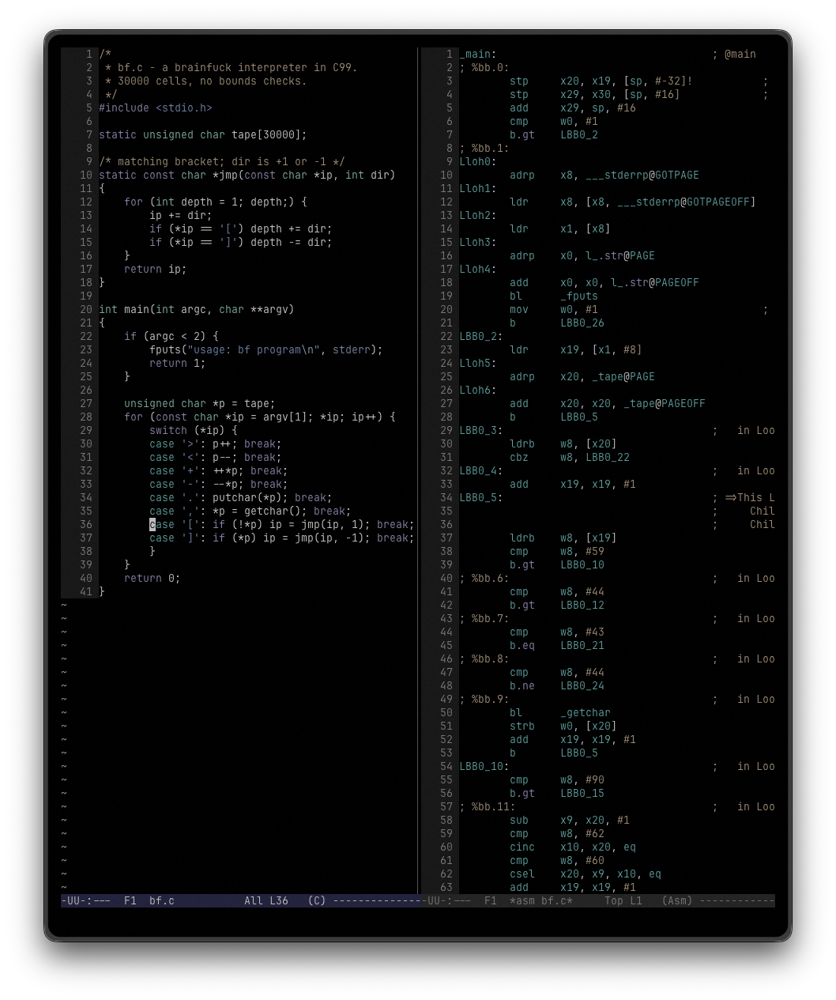
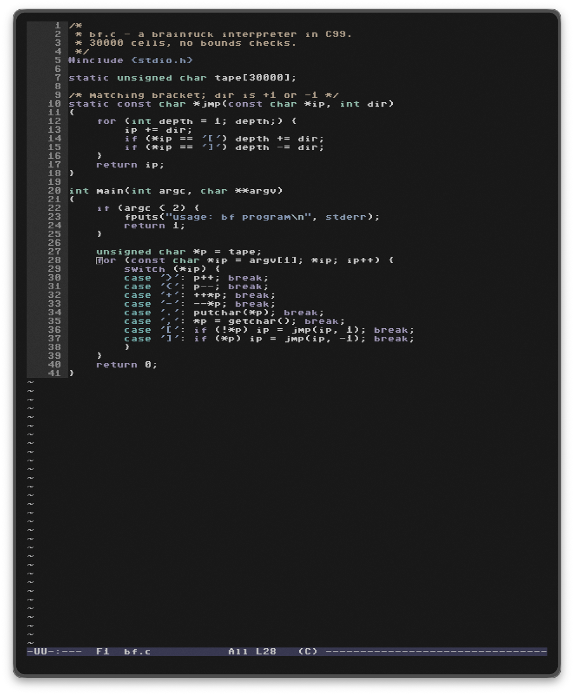
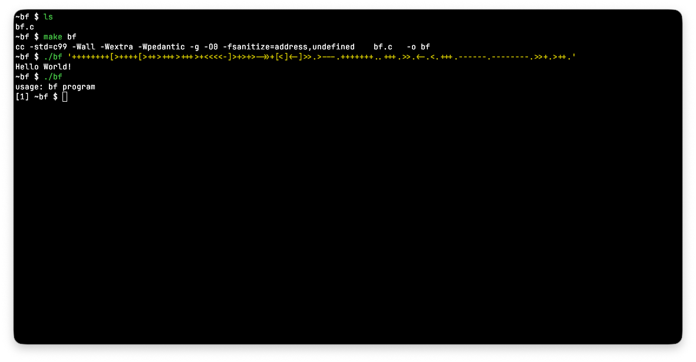

# dotfiles

My macOS setup. yabai and skhd for tiling, JankyBorders, Neovim (LazyVim), kitty, zsh with starship, lazygit, delta and btop.

## Theme and font

Kitty, Neovim, delta, lazygit, bat and btop share one theme, Catppuccin or Modus. It follows the macOS appearance (Latte/Mocha, Operandi/Vivendi) unless I pin it to light or dark. Kitty and Neovide share a font as well.

In Neovim it's `:Theme` and `:Font`. From a shell:

```bash
theme set modus            # follows the system
theme set catppuccin dark
theme font c64             # jetbrains, fira, terminus or c64
theme                      # what's set right now
```

The state is in `theme/state`. `theme` writes what each tool reads (kitty's auto theme files and `font.conf`, `bat/config`, a delta include), all gitignored. Shells that were already open keep the old bat theme until they're restarted.

## cmode

A separate terminal for writing C, set up like an old console: bare prompt, plain BSD tools, strict C99 builds and a small Neovim config without plugins (`nvim-c/`). It doesn't touch the normal setup.

<table>
  <tr>
    <td></td>
    <td></td>
  </tr>
  <tr>
    <td align="center"><code>cmode</code> with <code>:Asm</code></td>
    <td align="center"><code>cmode --c64</code></td>
  </tr>
</table>



<details>
<summary>Usage and keys</summary>

```bash
cmode                # Ghostty, in the current directory
cmode ~/src/kilo     # somewhere else
cmode --kitty        # kitty instead of Ghostty
cmode --c64          # Commodore 64 font
```

Ghostty is the default. It runs the screen through `ghostty-cmode/crt.glsl`, which is my cool-retro-term profile (`cool_retro_term.json`) redone as a shader. `--kitty` is the same thing without the CRT effect. Both use Modus Vivendi, the deuteranopia variant, on black.

The font starts out as whatever `theme font` is. `:Font` in nvim-c, or `cmode font <id>` in the shell, changes it for that window only.

The prompt is just the directory, with the exit code in front when something fails (`[134] ~/src/kilo $`). `CFLAGS` is `-std=c99 -Wall -Wextra -Wpedantic -g -O0 -fsanitize=address,undefined`, so `make foo` builds `foo.c` without a Makefile. In projects with a Makefile, run `bear -- make` once so clangd sees the real flags.

### nvim-c

Leader is Space. `?` shows these inside Neovim.

| Key | |
|---|---|
| `Space m` | build: `make`, or `make <file>` when there's no Makefile. Problems go to the quickfix list (`]q` `[q`) |
| `Space r` | run `./<file>` in a terminal split |
| `Space d` | debug it in lldb |
| `Space a` | the file's `-O2` assembly next to it |
| `K` | man page, libc first |
| `gd` `ge` | definition (`Ctrl-o` goes back) |
| `gD` `gE` | declaration |
| `gI` | implementation |
| `gy` | type definition |
| `gn` `grr` | references |
| `grn` | rename |
| `gK` `gh` | hover |
| `]d` `[d` | next/previous diagnostic, `Ctrl-w d` shows it |
| `Ctrl-x Ctrl-o` | completion, which never pops up by itself |
| `Space Space` `Space f` | find files |
| `Space /` | grep the project |
| `Space ,` `Space b` | open buffers |
| `-` | file browser |
| `Esc Esc` | leave a terminal split |
| `q` | close the quickfix list, a man or help page, or the assembly view |
| `:Hex` | hex view (open binaries with `nvim -b`) |
| `:Font` | this window's font |

The g-keys are the same ones as in my main Neovim config. The finders are fzf in a floating terminal, so the colour theme is the only plugin.

Indentation follows the file or its `.editorconfig`, and new files get 2 spaces. Anything past column 80 is highlighted. The statusline is an Emacs mode line, `-UU-:**-  F1  bf.c  62% L218  (C E1 W2)`: `**` is modified (`%%` read-only), then the tab number, file, position, line, and the filetype with clangd's error and warning counts.

</details>

## Install

```bash
git clone https://github.com/bassepeder/dotfiles.git ~/dotfiles
cd ~/dotfiles
brew bundle
./install.sh
```

`install.sh` symlinks the configs into place and checks that yabai and skhd still have their macOS permissions. It also downloads C64 Pro Mono, since that font can't be redistributed.

yabai isn't in the Brewfile. I run my own fork with fixes for macOS 27, see `yabai/README.md`.

## Local overrides

Anything machine specific (work vs. personal, secrets) lives in untracked files that the configs source if they exist:

- `~/.zshrc.local`
- `~/.gitconfig.local`
- `~/.yabairc.local`
