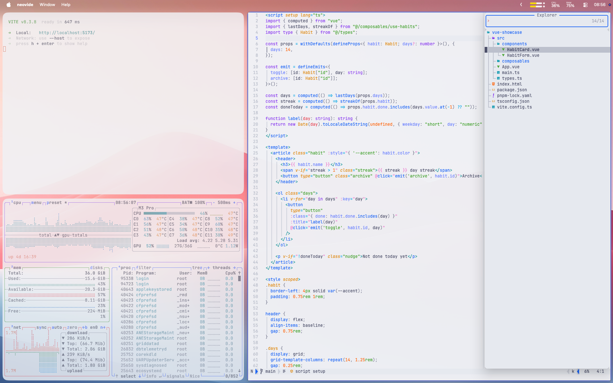
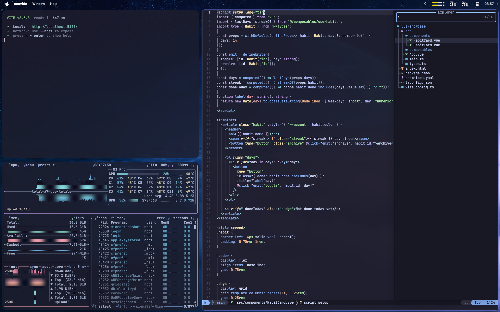
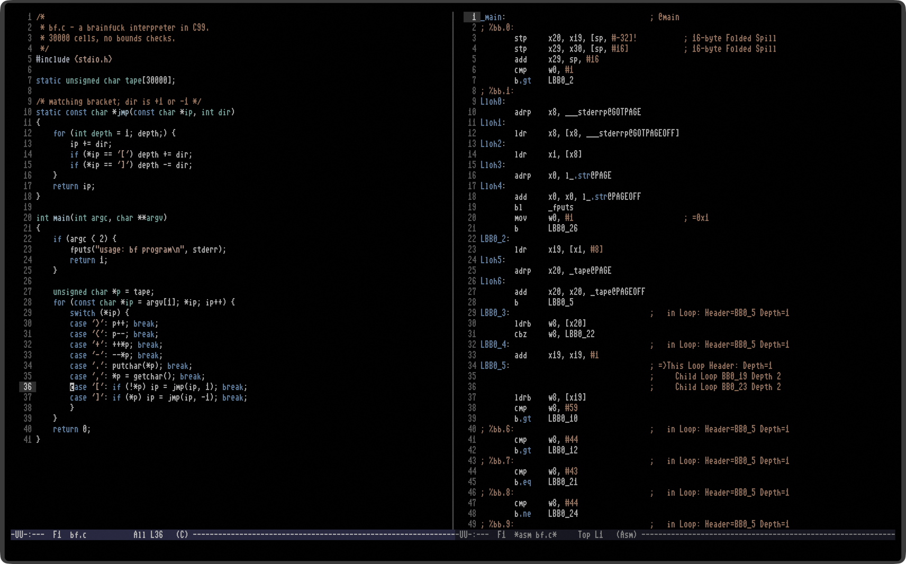

# dotfiles

My macOS setup. yabai and skhd for tiling, JankyBorders, Neovim (LazyVim) and Neovide, kitty, zsh with starship, lazygit, delta and btop. Plus cmode, a separate terminal for writing C.

<table>
  <tr>
    <td></td>
    <td></td>
  </tr>
  <tr>
    <td align="center">Light (Catppuccin Latte)</td>
    <td align="center">Dark (Catppuccin Mocha)</td>
  </tr>
</table>

## Theme and font

Kitty, Neovim, delta, lazygit, bat and btop share one theme, Catppuccin or Modus. It follows the macOS appearance (Latte/Mocha, Operandi/Vivendi) unless I pin it to light or dark. Kitty and Neovide share a font as well.

In Neovim it's `:Theme` and `:Font`. From a shell:

```bash
theme set modus            # follows the system
theme set catppuccin dark
theme font c64             # jetbrains, fira, terminus or c64
theme                      # what's set right now
```

The state is in `theme/state`. `theme` writes what each tool reads (kitty's auto theme files and `font.conf`, `bat/config`, a delta include), all gitignored.

## cmode

When I write C I want a simpler terminal and shell: a bare prompt, plain BSD tools and a small Neovim config without plugins (`nvim-c/`). I like strict C99 because the language is small enough to keep in my head, and without compiler extensions the code builds the same anywhere. `cmode` opens all of this in its own window and doesn't touch the normal setup.

<p align="center"></p>
<p align="center"><code>cmode</code></p>

<details>
<summary>Usage and keys</summary>

```bash
cmode                # Ghostty, in the current directory
cmode ~/src/kilo     # somewhere else
cmode --no-crt       # Ghostty without the CRT effect
cmode --no-c64       # my usual font instead of the Commodore 64 one
```

It runs in Ghostty with a CRT shader (`ghostty-cmode/crt.glsl`) and the Commodore 64 font. nvim-c has Emacs-style colours on black.

Panes work as in my kitty: `Cmd-D` / `Cmd-Shift-D` split, and `Cmd-h/j/k/l` move between them. A new pane is a cmode shell too.

`:Font` in nvim-c, or `cmode font <id>` in the shell, changes the font for that window only.

The prompt is just the directory, with the exit code in front when something fails. `CFLAGS` is `-std=c99 -Wall -Wextra -Wpedantic -g -O0 -fsanitize=address,undefined`, so `make foo` builds `foo.c` without a Makefile. In projects with a Makefile, run `bear -- make` once so clangd sees the real flags.

### nvim-c

The keys are the ones from my main config where there's an equivalent, LSP keys included. `,` is the leader, and `?` shows all of this inside Neovim.

| Key | |
|---|---|
| `,ff` `,fg` `,fb` | find files, grep, open buffers |
| `Space e` | file explorer (netrw as a sidebar, `q` closes it) |
| `Space Space` | list the problems, errors first (`Space i` all of them, `Space d` shows or hides the list) |
| `]d` `[d` | next/previous problem, with its message. `Ctrl-w d` shows it again |
| `gd` `ge` | definition (`Ctrl-o` goes back) |
| `gr` `gn` | references |
| `gD` `gE` | declaration |
| `gI` | implementation |
| `gy` | type definition |
| `K` `gh` | hover |
| `gK` | signature help (`Ctrl-k` while typing) |
| `]]` `[[` | next/previous use of the word under the cursor |
| `M` | man page for the word, system calls (2) and the C library (3) first |
| `,cr` | rename |
| `,ca` `,cA` | code action / source action |
| `,ss` `Space o` | symbols in the file (`,sS` / `Space O` in the project) |
| `Ctrl-x Ctrl-o` | completion, which never pops up by itself |

Problems, build errors and references end up in the quickfix list. There `Tab`/`Shift-Tab` step through the entries while the code follows, `Enter` jumps to one and closes the list, and `q` or `Esc` closes it. `,qf` brings it back. `Tab`/`Shift-Tab` also move through the results in the finders.

Building and running are commands rather than keys:

| Command | |
|---|---|
| `:make` | build, with the Makefile if there is one, else `make <file>`. It saves first and opens the list if there are problems |
| `:Run` | `make run` if the Makefile has that target, else `./<file>`, in a split. `q` closes it and stops the program |
| `:Debug` | lldb on `./<file>` in a split |
| `:Asm` | the file's `-O2` assembly next to it |
| `:Hex` | hex view (open binaries with `nvim -b`) |
| `:Font` | this window's font |

`:w` formats C with clang-format (built into clangd), using the nearest `.clang-format`, so `~/.clang-format` unless the project has its own. While typing, indentation follows the file or its `.editorconfig`, and new files get 2 spaces. Anything past column 80 is highlighted.

</details>

## Install

```bash
git clone https://github.com/bassepeder/dotfiles.git ~/dotfiles
cd ~/dotfiles
brew bundle
./install.sh
```

`install.sh` symlinks the configs into place and checks that yabai and skhd still have their macOS permissions. It also downloads the Commodore 64 font (Pet Me 64 2Y), which Homebrew doesn't have.

yabai isn't in the Brewfile. I run my own fork with fixes for macOS 27, see `yabai/README.md`.

## Local overrides

Anything machine specific (work vs. personal, secrets) lives in untracked files that the configs source if they exist:

- `~/.zshrc.local`
- `~/.gitconfig.local`
- `~/.yabairc.local`
